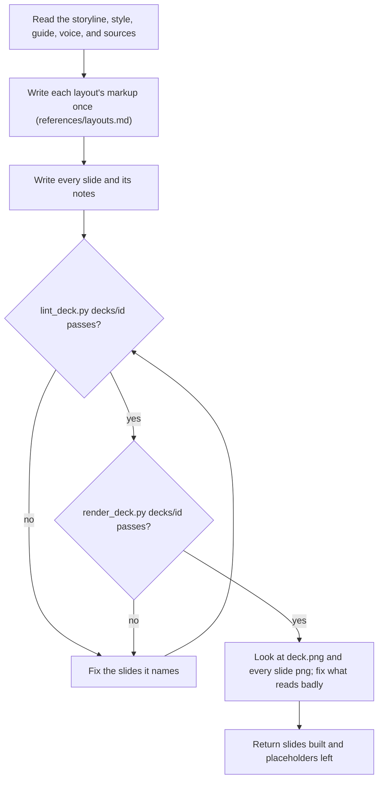

## Goal

Every slide in `decks/<id>/slides/` built in the Slides format, proving its title, passing lint and render.

## In

- The deck folder, and any findings or comments to fix, from the prompt (ask if missing)
- `storyline.md` (approved), the style, `docs/deck/guide.md` and `voice.md` if present, the storyline's Sources
- Scripts named here run as `python3 ${CLAUDE_PLUGIN_ROOT}/scripts/<name>.py`

## Out

- `slides/<id>.html` per storyline slide; images copied into `assets/`
- `screens/<id>.png` and `screens/deck.png` from `render_deck.py`

## Flow

## Rules

- **Writing a heading** → the storyline's title, word for word
  - _Because:_ the requester approved those words; `lint_deck.py` compares them
- **A title can't fit two lines** → stop; return its S number and a shorter title for the storyline
  - _Because:_ the storyline is the contract, and only write-deck changes it
- **The first slide of a layout** → settle its markup; copy it for every later slide of that layout
  - _Because:_ identical markup keeps headings still between slides
- **Any colour, size, or font** → only the style's; add nothing
  - _Because:_ a palette of five reads as designed; one stray hex reads as a mistake
- **Body over its word cap or the slide overflows** → move words to the notes; if it's still over, return it to split
  - _Because:_ smaller type to fit is the classic unreadable slide
- **Writing notes on a presented deck** → what the presenter says, as spoken, in voice.md's voice
  - _Because:_ the slide shows evidence; the notes carry the explanation
- **A figure, name, or quote isn't in the sources** → `[__]` in its place
  - _Because:_ an invented fact in a deck is a lie told in the requester's name
- **Writing any words** → follow ../review-deck/references/copy.md
  - _Because:_ the copy reviewer holds the slides to it, and rewriting later costs a round
- **Fixing findings or comments** → change only the slides they name, and only what they name
  - _Because:_ an unasked change can break what the requester already approved
- **Checks pass** → still open the screens and look, as the audience would
  - _Because:_ scripts catch overflow and contrast, not a slide that's crowded or lopsided

## Done When

- [ ] `lint_deck.py decks/<id>` passes: every storyline slide exists and matches
- [ ] `render_deck.py decks/<id>` passes, and you've looked at every screen
- [ ] The return lists each `[__]` placeholder by S number

## Never

- Editing `storyline.md` or the style
- Inventing a statistic, quote, customer, logo, or image
- Text under the style's sizes to make content fit

## More

- [references/layouts.md](references/layouts.md): each layout's job, shape, word cap, and markup
- [references/craft.md](references/craft.md): margins, hierarchy, colour, charts, tables, images
- [../review-deck/references/copy.md](../review-deck/references/copy.md): how the words on slides and in notes should read
- [../write-deck/references/storytelling.md](../write-deck/references/storytelling.md): why each slide is one claim and its evidence
