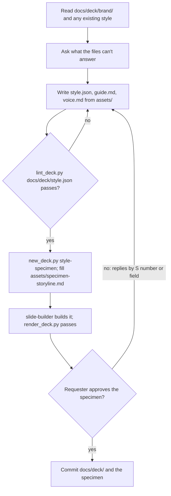

## Goal

An approved `docs/deck/` style that every later deck is built and checked against, shown as a rendered specimen deck.

## In

- `docs/deck/brand/`: brand guide, logos, past decks, writing samples, if any (ask if missing)
- The requester's answers to what the files don't settle (references/brand-intake.md)
- Scripts named here run as `python3 ${CLAUDE_PLUGIN_ROOT}/scripts/<name>.py`

## Out

- `docs/deck/style.json`, `guide.md`, `voice.md`, and `assets/` (references/style-format.md)
- `decks/<NNN>-style-specimen/`: one slide per layout, rendered to `screens/deck.png`

## Flow

## Rules

- **Choosing a value** → take it from the brand files and name the file; adjectives aren't evidence
  - _Because:_ "modern and clean" gives every deck the same look; their files give theirs
- **Brand colours** → map them to roles: background, text, muted, accent; one accent unless the brand needs two
  - _Because:_ a deck needs roles, and every extra accent weakens the one that marks the point
- **A pair fails contrast** → keep the brand colour for fills; add a darker text variant
  - _Because:_ the brand still shows, and words stay readable on a projector
- **A rule a script can check** → put it in style.json: title case, title length, banned words
  - _Because:_ checked rules hold on every write; prose rules hold only when someone remembers
- **A rule that needs judgment** → a guide.md line in kit's rule format, with its reason
  - _Because:_ the reason lets the builder apply it to cases the rule didn't name
- **Writing voice.md** → quote the requester's own sentences, with their source files
  - _Because:_ quoted examples transfer a voice; descriptions of it don't
- **The specimen's content** → a real topic the requester presents on; `[__]` for every figure they didn't give
  - _Because:_ a style judged on lorem ipsum gets approved, then rejected on the first real deck
- **Replies by S number or field** → apply them; re-lint; rebuild the slides they touch; re-render
  - _Because:_ a changed colour can fail a contrast pair the last render passed

## Done When

- [ ] `lint_deck.py docs/deck/style.json` and `lint_deck.py decks/<specimen>` pass
- [ ] `render_deck.py decks/<specimen>` passes; deck.png shown to the requester
- [ ] Every colour and font in style.json cites a brand file, or the requester's reply
- [ ] Requester approved; docs/deck/ and the specimen committed

## Never

- Committing a brand file the requester marked confidential outside `docs/deck/brand/`
- Recreating another company's brand the requester doesn't work for

## More

- [references/style-format.md](references/style-format.md): the style file's fields, the guide, the voice guide, choosing values
- [references/brand-intake.md](references/brand-intake.md): what to read in brand files and what to ask
- [assets/style.json](assets/style.json): the starter style; also a deck's style when no house style exists
- [assets/guide.md](assets/guide.md): the guide to fill
- [assets/voice.md](assets/voice.md): the voice guide to fill
- [assets/specimen-storyline.md](assets/specimen-storyline.md): one slide per layout, for judging the style
