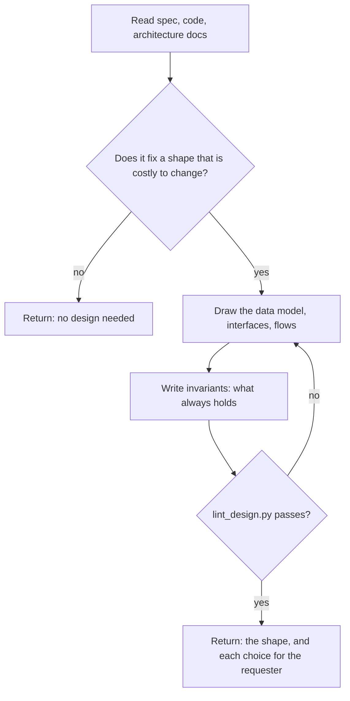

## Goal

A short `design.md` fixing the shapes that are costly to change, so tasks can be built against it.

## In

- Spec ID (ask if missing); `specs/<id>/spec.md` with `status: approved`
- The codebase, `docs/architecture/`, and `docs/decisions/` for shapes already settled
- `docs/product/brief.md`, if present, for the nouns the people use

## Out

- `specs/<id>/design.md` with `status: draft` (references/design-format.md)

## Flow

## Rules

- **The spec's behaviors need no new shape** → return "no design needed"; write nothing
  - _Because:_ a design for a CRUD screen is a second spec nobody reads
- **A shape is costly to reverse** → draw it: a persistent model, a protocol, a state machine, a public contract
  - _Because:_ the plan and every parallel task build against these shapes
- **Naming an entity or message** → use the word the spec and brief use
  - _Because:_ a second vocabulary splits the design from the tests and the code
- **A rule must always hold** → write it as an invariant, with an ID and one sentence
  - _Because:_ each invariant becomes a unit test, and a vague one can't fail
- **Choosing between shapes** → pick one, and put the other in the reply with its cost
  - _Because:_ the requester approves the design, so the strongest alternative must be visible
- **Interfaces between tasks' work** → give exact names, inputs, and outputs
  - _Because:_ builders in parallel can't ask each other what a function takes
- **The design contradicts an accepted record** → say so in the reply; leave the record alone
  - _Because:_ only the requester supersedes a decision

## Done When

- [ ] `lint_design.py specs/<id>/design.md` passes
- [ ] Every shape the spec's behaviors depend on appears once, with its invariants
- [ ] The reply lists each choice made and its strongest alternative

## Never

- Editing spec.md, or writing app code or tests
- File layout or library choices; plan.md owns those
- Paragraphs; a diagram, a type, or one line says it

## More

- [references/design-format.md](references/design-format.md): sections, invariants, limits, when a spec needs one
- [assets/design-template.md](assets/design-template.md): blank design to copy
- [../../scripts/lint_design.py](../../scripts/lint_design.py): format lint; also runs on every write
