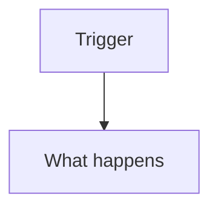

# Design: <feature name>

<One line: the shape in plain words.>

## Data model

```ts
// entities, fields, and relations; how a record is versioned or retired
```

## Interfaces

```ts
// the signatures and messages parts of the build agree on
```

## Flows



## Invariants

- **<n>.I1 <situation>** → <the rule that always holds>
