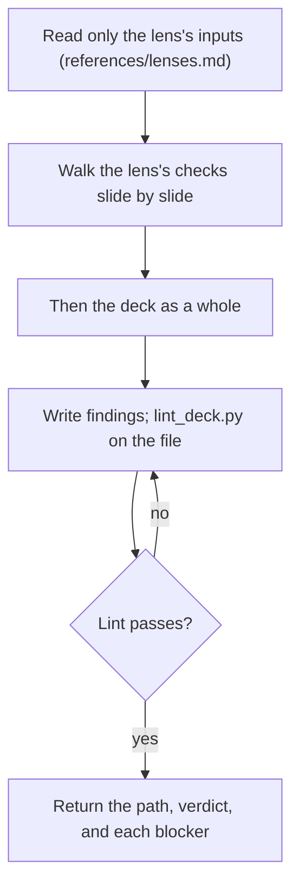

## Goal

One lens's findings, each blocker naming the slide, its evidence, and what the audience would get wrong.

## In

- The deck folder, the lens (`story`, `design`, or `copy`), and the round, from the prompt (ask if missing)
- Only that lens's inputs (references/lenses.md); scripts run as `python3 ${CLAUDE_PLUGIN_ROOT}/scripts/<name>.py`

## Out

- `decks/<id>/reviews/<lens>-r<round>.md`

## Flow

## Rules

- **Reading** → only the lens's inputs; the copy lens never opens the storyline or sources
  - _Because:_ the audience meets the deck without them; a reviewer who knows the intent forgives the gaps
- **A blocker** → only when the audience would misread, miss, or doubt the point
  - _Because:_ blockers send slides back for another round; taste alone isn't worth one
- **Each finding** → exactly one piece of evidence: a screen, a quoted slide line, or a storyline line
  - _Because:_ a finding the builder can't see is a finding the builder can't fix
- **A copy finding** → quote the words and give the rewrite
  - _Because:_ "too vague" starts an argument; a better sentence ends one
- **A finding the lint already reports** → leave it out
  - _Because:_ the builder fixed lint before review; repeating it buries the judgment only you can make
- **Round 2** → check that each round-1 blocker is fixed; raise new blockers only for regressions
  - _Because:_ a review that moves the goalposts never converges

## Done When

- [ ] `lint_deck.py decks/<id>/reviews/<lens>-r<round>.md` passes
- [ ] Every blocker cites one piece of evidence the builder can open
- [ ] `verdict: fail` exactly when there's a blocker

## Never

- Editing slides, the storyline, or the style
- A blocker for taste with no effect on the audience

## More

- [references/lenses.md](references/lenses.md): each lens's inputs, checks, blockers, and the findings format
- [references/copy.md](references/copy.md): the copy rules and the tells of generated text
- [../build-slides/references/craft.md](../build-slides/references/craft.md): what the design lens judges against
