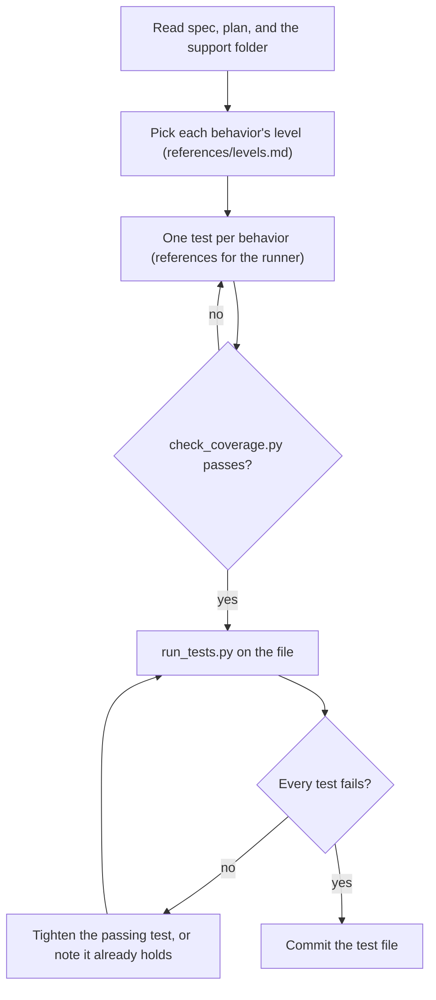

## Goal

One test per behavior, at the cheapest level that proves it, failing until the behavior is real.

## In

- Spec ID (ask if missing); `specs/<id>/spec.md`
- `specs/<id>/plan.md`: routes and entry points, and its Tests levels when it has them
- `specs/<id>/design.md`, when there is one: its invariants each need a test
- `.claude/kit/config.json`: `tests.runner`, `tests.acceptance`, and `tests.unit` and `tests.support` when set
- The support folder (`tests.support`) and the tests already there, read before writing a line
- Scripts named here run as `python3 ${CLAUDE_PLUGIN_ROOT}/scripts/<name>.py`

## Out

- End-to-end tests at `tests.acceptance`, and unit-level ones at `tests.unit.acceptance`, with `{spec}` filled
- Helpers a second file would copy, added to `tests.support`; all committed

## Flow

## Rules

- **Naming a test** → `<n>.B<k> <situation>`, the full ID and words from the spec
  - _Because:_ the gate and the report find tests by behavior ID
- **Choosing a level** → plan.md's Tests section, else references/levels.md; unit unless a browser or the whole stack is the point
  - _Because:_ end-to-end tests are the slowest in every later gate, so each one is a decision
- **Writing an end-to-end test** → put `// e2e: <why a unit test can't prove it>` above it
  - _Because:_ `check_coverage.py` fails an unexplained one, and the reason shows what the test buys
- **A helper another test file has, or would need** → import it from the support folder; add it there if missing
  - _Because:_ copied setup code drifts, and every copy is one more place to fix
- **Writing for the runner** → follow references/playwright.md or references/vitest.md, by the file's runner
  - _Because:_ each runner has its own way to observe what a person would
- **Asserting storage or side effects** → check through the UI or a public interface
  - _Because:_ reading internals couples the test to one implementation
- **A delay or expiry is part of the behavior** → move the clock or age stored state; never sleep
  - _Because:_ a real wait costs every run on every machine
- **A test passes before the build** → tighten it until it can fail
  - _Because:_ a test that can't fail proves nothing
- **Behavior already holds in the app** → keep the passing test; tell the orchestrator
  - _Because:_ the report should say it was already true

## Done When

- [ ] `check_coverage.py <id>` and `check_tests.py` pass
- [ ] Every test ran and failed, or is reported as already holding
- [ ] The test files are committed

## Never

- Skipped, focused, or todo tests (`.skip`, `.only`, `.todo`, `.fixme`)
- Importing app internals into an acceptance test
- Editing spec.md or app code

## More

- [references/levels.md](references/levels.md): which level proves a behavior, and the end-to-end budget
- [references/playwright.md](references/playwright.md): browser tests: a complete example file
- [references/vitest.md](references/vitest.md): Vitest and Jest tests: a complete example file
- [../../scripts/check_coverage.py](../../scripts/check_coverage.py): one test per behavior, reasons, budget
- [../../scripts/check_tests.py](../../scripts/check_tests.py): helpers shared, not copied
- [../../scripts/run_tests.py](../../scripts/run_tests.py): runs one spec's tests with the configured runner
