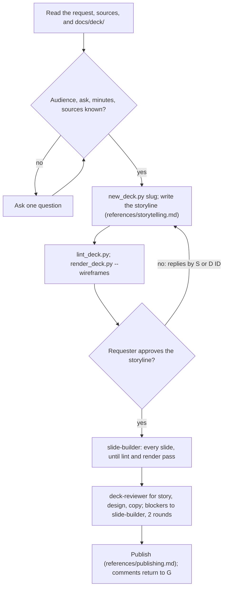

## Goal

A deck whose titles alone make the argument, approved as a storyline first, built, reviewed, and published to Claude Slides.

## In

- The request: topic, audience, the ask, talk length, source material (ask if missing)
- `docs/deck/` if present: `style.json`, `guide.md`, `voice.md`; `docs/product/brief.md` for product decks
- Scripts named here run as `python3 ${CLAUDE_PLUGIN_ROOT}/scripts/<name>.py`

## Out

- `decks/<NNN>-<slug>/`: storyline.md, screens/, slides/, reviews/ (references/storyline-format.md)
- A Claude Slides artifact, its link in `published.json` and in the reply

## Flow

## Rules

- **No `docs/deck/style.json`** → offer `/kit:define-deck-style`; else copy its assets/style.json into the deck folder
  - _Because:_ every check measures against a style; a deck without one has no palette to hold
- **Asking** → only audience, the ask, length, and sources; a guess for anything else becomes a D item
  - _Because:_ one round trip through the storyline beats a questionnaire before it
- **Writing the storyline** → write every title first, then read them alone, in order
  - _Because:_ the titles are the argument; a slide that doesn't advance it gets cut here, cheaply
- **A figure, name, or quote isn't in the sources** → write a `[__]` placeholder and list it for the requester
  - _Because:_ an invented number in a deck is a lie told in the requester's name
- **Showing the storyline** → the titles as a numbered list, wireframes.png, D items, and placeholders; ask to approve
  - _Because:_ a list of claims gets real feedback; a finished deck gets polish requests
- **Replies by ID** → apply each; keep S numbers; re-lint and re-render; show what changed
  - _Because:_ reviews and comments cite S numbers; renumbering breaks them
- **Approved** → set `status: approved`; commit the deck folder
  - _Because:_ slide-builder starts only from an approved storyline
- **Building** → one slide-builder for the whole deck, with the deck folder in its prompt
  - _Because:_ one hand keeps each layout's markup identical, so headings don't hop
- **Reviewing** → three deck-reviewers in parallel, one per lens; blockers left after round 2 become questions
  - _Because:_ fresh, separate eyes; the copy reviewer never sees the storyline, like the audience
- **Comments on the published deck** → pull hand edits, send comments to slide-builder, publish, reply
  - _Because:_ the requester's edits in Slides win over the repo's copy
- **A correction repeats from an earlier deck** → propose it as a line in docs/deck/guide.md
  - _Because:_ the next deck then starts from what this one learned

## Done When

- [ ] `lint_deck.py decks/<id>` and `render_deck.py decks/<id>` pass
- [ ] The latest story, design, and copy reviews pass, or the requester answered each blocker
- [ ] Published; the link and every remaining `[__]` placeholder are in the reply
- [ ] The deck folder is committed, with `published.json`

## Never

- Inventing a statistic, quote, customer, or logo
- Building slides from an unapproved storyline
- Publishing over the requester's hand edits without pulling them

## More

- [references/storyline-format.md](references/storyline-format.md): the storyline, its IDs, and its limits
- [references/storytelling.md](references/storytelling.md): answer first, claim titles, evidence, splitting, length
- [references/publishing.md](references/publishing.md): Claude Slides, uploads, comments, pulling hand edits
- [assets/storyline-template.md](assets/storyline-template.md): blank storyline, copied for each new deck
- [../define-deck-style/assets/style.json](../define-deck-style/assets/style.json): a starter style for a deck without one
